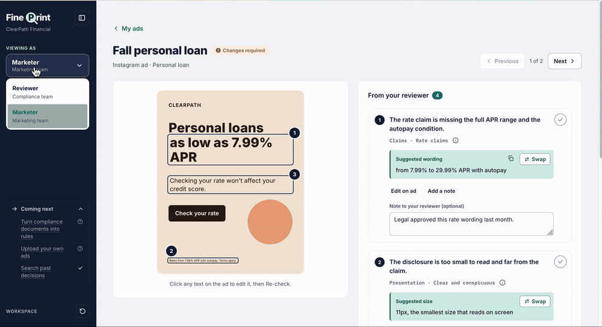
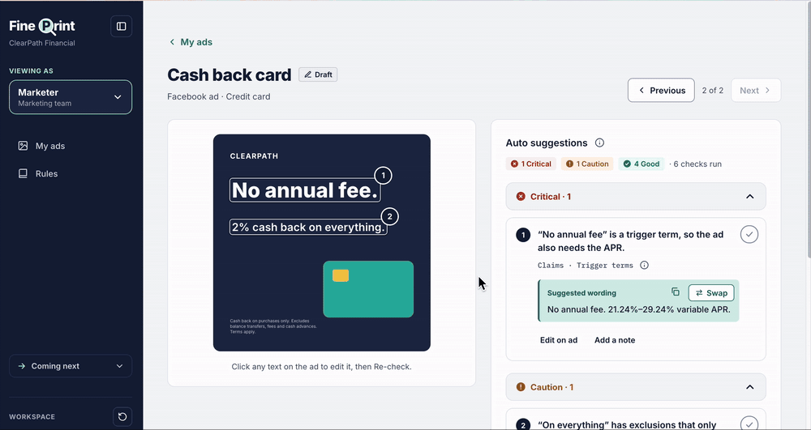
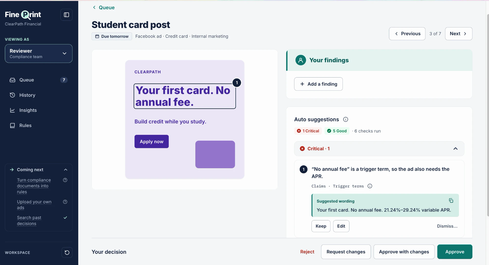
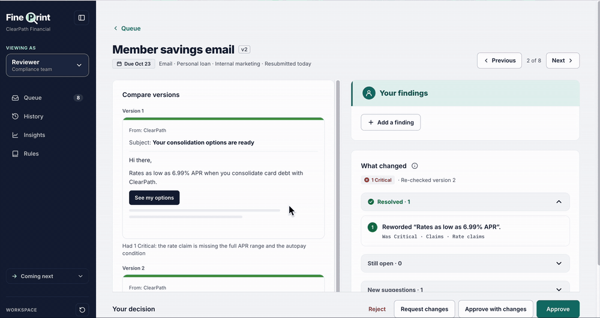
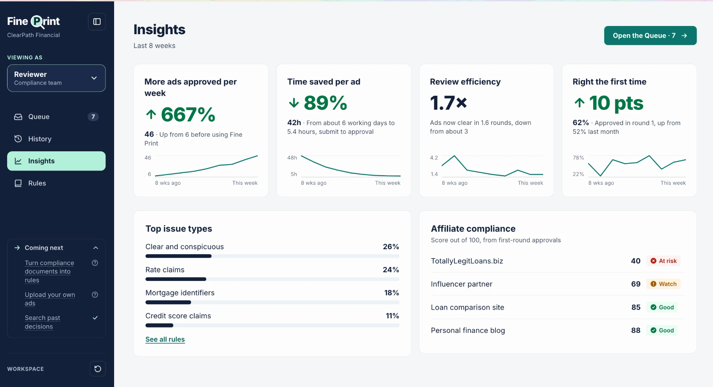
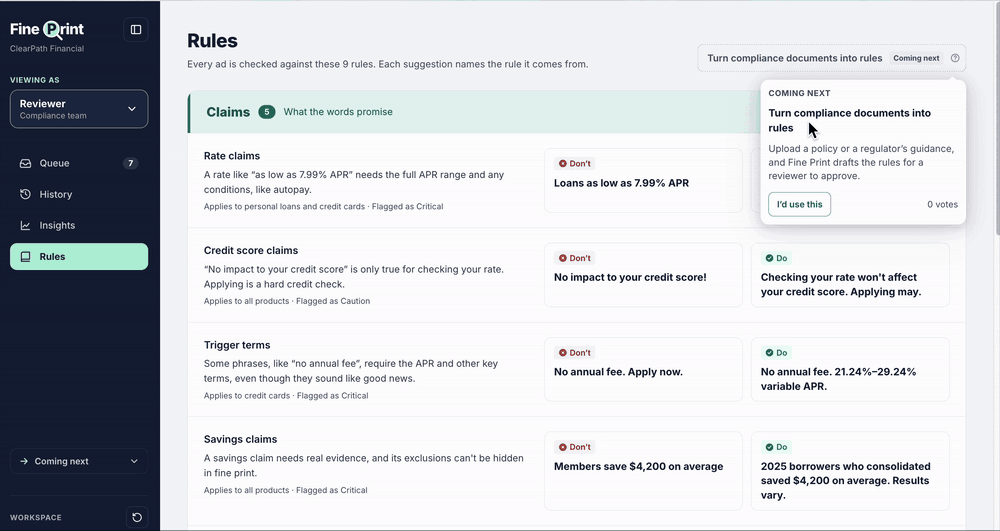

# Fine Print

**Over 500% more ads approved a week. Submit to approval about 90% faster.**

Fine Print is a marketing-compliance review tool for ClearPath Financial, a fictional consumer lender. Marketers check their ads before submitting. Reviewers get every ad prepared, with suggestions pinned on the words.

**Try it:** the live link is in the email I sent with this repo (it carries a private access key).

## What to try

Switch roles at **VIEWING AS**, top left.

### 1. Pre-check: fix it before anyone reviews it
The marketer runs the same check the reviewer will see, on their own ad, before submitting. Each suggestion is pinned on the exact words, with the wording to use instead. Click any text on the ad to edit it, then **Re-check**. Suggestions never block Submit. When an ad comes back, what the reviewer kept sits at the top.



### 2. Fix it in one click
**Swap** puts the suggested wording on the ad, or makes small print readable, and marks it resolved. No copy and paste, no new upload.



### 3. A prepared review
Every ad arrives with its suggestions pinned on the words, grouped by severity. Keep what matters, add your own, then decide. Done ads go back to the Queue.



### 4. Only what changed
A resubmission shows the old version above the new one, with what got fixed in green.



### 5. Insights
Approvals per week, time saved, rounds per ad and first-round approvals, each against the weeks before Fine Print.



### 6. Coming next
Ideas we haven't built sit where they'd live, marked "Coming next". Vote for the ones you'd use.



## Assumptions

- **Two roles:** Marketer and Reviewer, switched in the sidebar. No logins.
- **Reviewers suggest, marketers change.** A reviewer never edits the ad, so whoever approves the words didn't write them.
- **Sample ads instead of uploads.** Each ad is text on a template, which is what lets suggestions pin to exact words and fixes happen in one click.
- **Prepared and live checks.** Sample ads come with their auto check already run. Re-check and Submit run a live check with Claude when an API key is set. The check never blocks Submit or Approve.
- **The numbers are modeled.** Three reviewers and about 45 ads a week, with faster first reviews and fewer rounds. The sample history follows that ramp, and every number on screen is computed from it.
- **Rule wording is simplified** and isn't legal advice.

Every other decision is in [`BLOCKED.md`](BLOCKED.md); what's built is in [`PROGRESS.md`](PROGRESS.md).

## What's next

- **Turn compliance documents into rules:** upload a policy, get rules to review.
- **Upload your own ads:** needs the text read out of images, so pins land on the right words.
- **Search past decisions:** how similar ads were decided, and why.

## Run it locally

Needs Node 22+ and Python 3.12+.

```bash
npm install
python3 -m venv .venv && source .venv/bin/activate
pip install -r requirements-dev.txt
cp .env.example .env      # add ANTHROPIC_API_KEY for live checks (optional)

npm run dev:api           # API on :8000
npm run dev               # app on http://localhost:5173
```

The sample data loads on first visit. **Reset sample data** (sidebar, bottom) starts over.

Checks: `npm run lint`, `npm run build`, `npm test` (unit and server), `npm run test:e2e` (browser).

## Deploy (Vercel)

1. Import this repo into Vercel.
2. Add these variables (Production and Preview), then redeploy:

   | Variable | Value |
   | --- | --- |
   | `ACCESS_KEY` | Any long random value. The site then only opens from `https://<your-app>/?key=<ACCESS_KEY>`. |
   | `DATABASE_URL` | Your Turso database URL (`libsql://…`) |
   | `DATABASE_AUTH_TOKEN` | A Turso token for it |
   | `ANTHROPIC_API_KEY` | For live checks (optional) |

3. Set the function region to your Turso database's region (Settings → Functions).
4. Open the link. The sample data builds itself on first visit.

Every running copy of the function uses the same Turso database, so everyone sees the same data.

Optional: `ANTHROPIC_MODEL` (default `claude-sonnet-5-5`), and `LIVE_CHECKS_PER_MINUTE` / `LIVE_CHECKS_PER_DAY` (default 10 per visitor, 200 total) to cap API spend.

## Stack

React, TypeScript, Vite and antd on the front end. Flask, libSQL (SQLite locally, Turso in production) and the Anthropic SDK on the server. Vitest, pytest and Playwright for tests.
