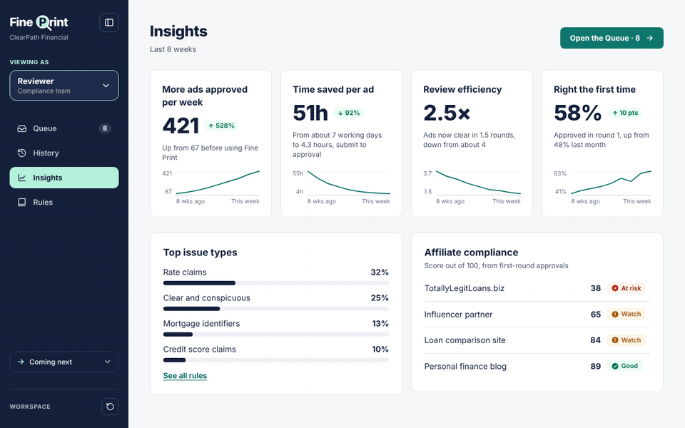
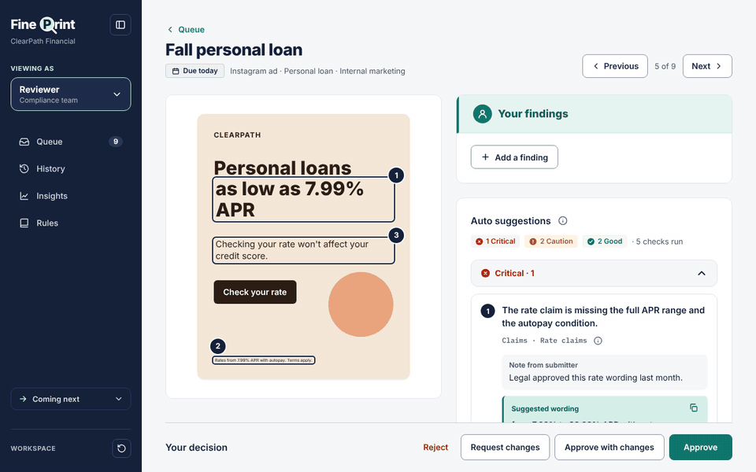
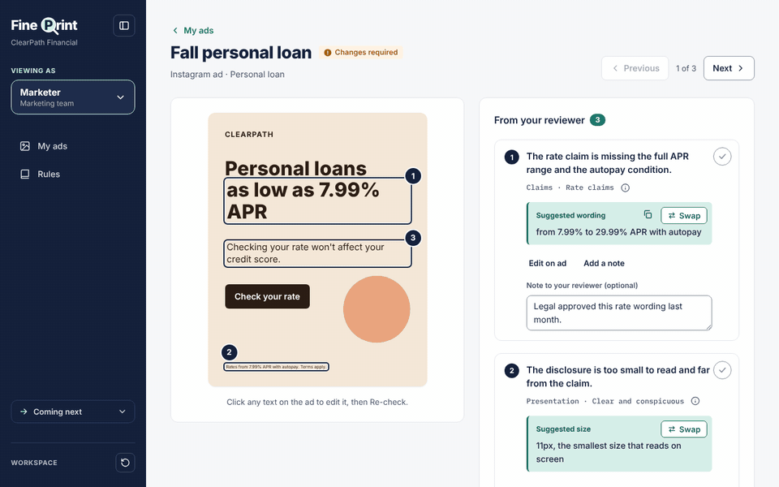
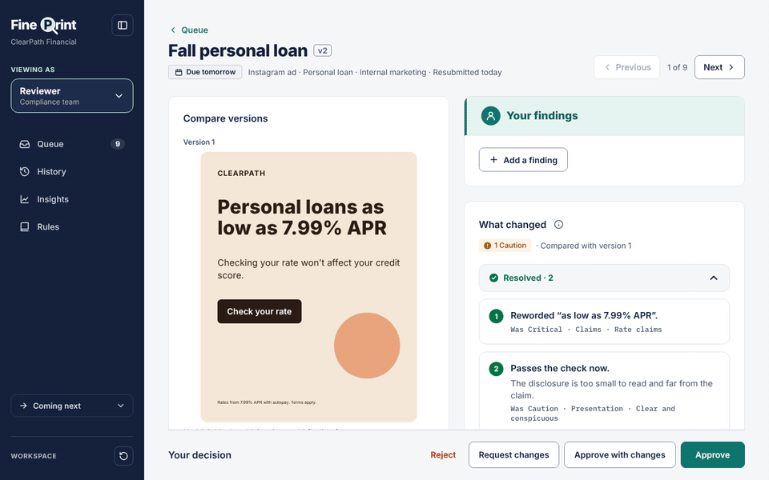
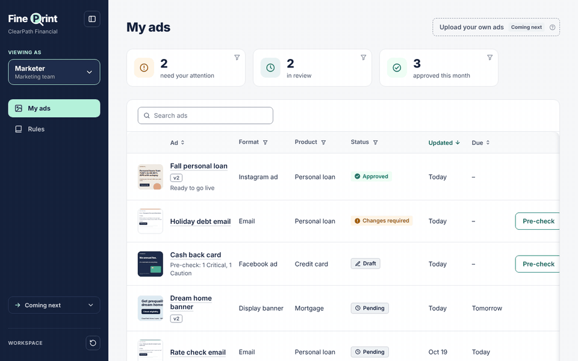

# Fine Print

**Over 500% more ads approved a week. Submit to approval about 90% faster.**

Fine Print is a marketing-compliance review tool for ClearPath Financial, a fictional consumer lender. Marketers check their ads before submitting. Reviewers get every ad prepared, with suggestions pinned on the words.

**Try it:** `<your link here>` (the link includes its access key)



## What to try

Switch roles at **VIEWING AS**, top left.

### 1. A prepared review
Every ad arrives with its suggestions pinned on the words, grouped by severity. Keep what matters, add your own, request changes.



### 2. Fix it in one click
The marketer sees what the reviewer kept, at the top. **Swap** puts in the suggested wording, or a readable size, and marks it resolved.



### 3. Only what changed
A resubmission shows the old version above the new one, with what got fixed in green.



### 4. Insights
Approvals per week, time saved, rounds per ad and first-round approvals, each against the week before Fine Print.

### 5. Coming next
Ideas we haven't built sit where they'd live, marked "Coming next". Vote for the ones you'd use.



## Assumptions

- **Two roles:** Marketer and Reviewer, switched in the sidebar. No logins.
- **Reviewers suggest, marketers change.** A reviewer never edits the ad, so whoever approves the words didn't write them.
- **Sample ads instead of uploads.** Each ad is text on a template, which is what lets suggestions pin to exact words and fixes happen in one click.
- **Prepared and live checks.** Sample ads come with their auto check already run. Re-check and Submit run a live check with Claude when an API key is set. The check never blocks Submit or Approve.
- **The numbers are modeled.** Three reviewers and about 100 ads a week, with faster first reviews and fewer rounds. The sample history follows that ramp, and every number on screen is computed from it.
- **Rule wording is simplified** and isn't legal advice.

Every other decision is in [`BLOCKED.md`](BLOCKED.md); what's built is in [`PROGRESS.md`](PROGRESS.md).

## What's next

- **Turn compliance documents into rules:** upload a policy, get rules to review.
- **Upload your own ads:** needs the text read out of images, so pins land on the right words.
- **Search past decisions:** how similar ads were decided, and why.

## Run it locally

Needs Node 22+ and Python 3.12+.

```bash
npm install
python3 -m venv .venv && source .venv/bin/activate
pip install -r requirements-dev.txt
cp .env.example .env      # add ANTHROPIC_API_KEY for live checks (optional)

npm run dev:api           # API on :8000
npm run dev               # app on http://localhost:5173
```

The sample data loads on first visit. **Reset sample data** (sidebar, bottom) starts over.

Checks: `npm run lint`, `npm run build`, `npm test` (unit and server), `npm run test:e2e` (browser).

## Deploy (Vercel + Turso)

1. **Database:** at [turso.tech](https://turso.tech), create a database, then copy its URL (`libsql://…`) and create a token.
2. **Vercel:** import this repo. Add these variables for Production and Preview, then redeploy:

   | Variable | Value |
   | --- | --- |
   | `DATABASE_URL` | Turso URL |
   | `DATABASE_AUTH_TOKEN` | Turso token |
   | `ANTHROPIC_API_KEY` | For live checks (optional) |
   | `ACCESS_KEY` | Any long random value. The site then only opens from `https://<your-app>/?key=<ACCESS_KEY>`. |

3. **Open the link.** The first visit creates the tables and the sample data.

Optional: `ANTHROPIC_MODEL` (default `claude-sonnet-5-5`), and `LIVE_CHECKS_PER_MINUTE` / `LIVE_CHECKS_PER_DAY` (default 10 per visitor, 200 total) to cap API spend.

## Stack

React, TypeScript, Vite and antd on the front end. Flask, libSQL (SQLite locally, Turso in production) and the Anthropic SDK on the server. Vitest, pytest and Playwright for tests.
